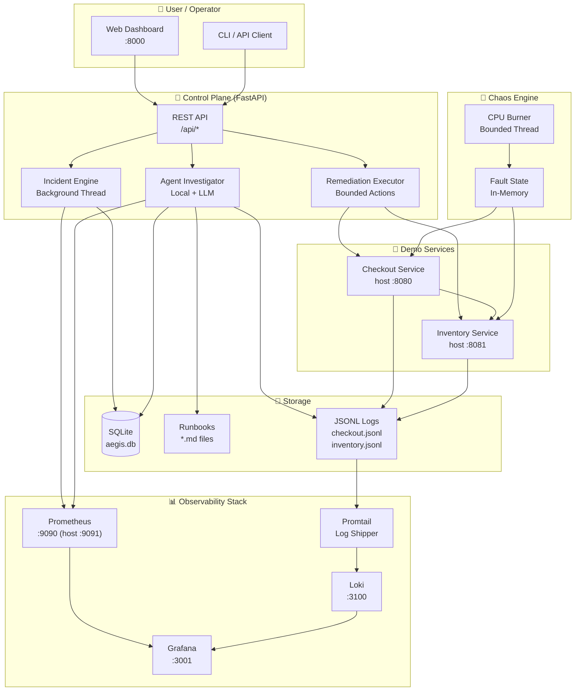
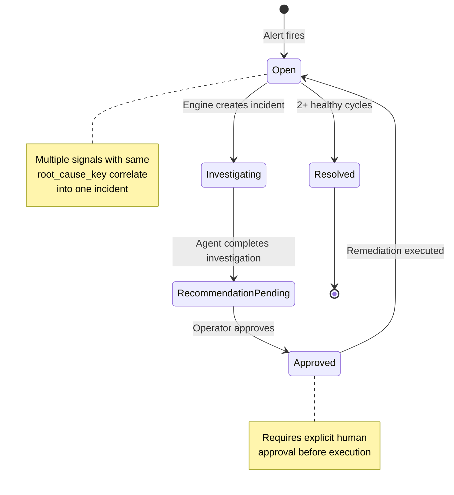

# Aegis Architecture & Security Analysis

## 🏗️ System Architecture



## 🔌 API Endpoints

| Method | Endpoint | Description | Auth |
|--------|----------|-------------|------|
| `GET` | `/` | Web dashboard | No |
| `GET` | `/healthz` | Liveness | No |
| `GET` | `/readyz` | Readiness: database, engine, Prometheus, Loki | No |
| `GET` | `/metrics` | The control plane's own Prometheus metrics | No |
| `GET` | `/api/engine/status` | Engine heartbeat and backend circuit breakers | No |
| `GET` | `/api/overview` | Dashboard overview | No |
| `GET` | `/api/incidents` | List incidents (paginated) | No |
| `GET` | `/api/incidents/export` | Export as JSON/CSV | No |
| `GET` | `/api/incidents/{incident_id}` | Get incident detail | No |
| `POST` | `/api/incidents/{incident_id}/investigate` | Trigger investigation | Yes |
| `POST` | `/api/incidents/{incident_id}/approve` | Approve remediation | Yes |
| `POST` | `/api/incidents/{incident_id}/execute` | Execute approved fix | Yes |
| `POST` | `/api/incidents/batch/approve` | Batch approve all | Yes |
| `POST` | `/api/chaos` | Inject chaos fault | Yes (503 while no key is set) |
| `GET` | `/api/metrics` | Metric snapshot | No |
| `GET` | `/api/logs` | Recent logs | No |
| `GET` | `/api/runbooks` | List runbooks | No |
| `GET` | `/api/audit` | Audit log | Yes |
| `POST` | `/api/engine/run-once` | Force engine cycle | Yes |

"Yes" means `Authorization: Bearer $AEGIS_API_KEY` is required whenever `AEGIS_API_KEY` is set. With no key the demo runs open (and logs a security warning), except fault injection, which stays disabled. Every request must also carry an allowed `Host` header (`AEGIS_ALLOWED_HOSTS`).

## 🔄 Incident Lifecycle



## 🔒 Security Analysis

### ✅ Strengths

| Area | Implementation |
|------|----------------|
| **SQL Injection** | Parameterized queries throughout `storage.py` |
| **Path Traversal** | `Path(slug).name` in `_read_runbook()` |
| **Timing Attacks** | `hmac.compare_digest()` for API key comparison |
| **Auth on state changes** | `AEGIS_API_KEY` guards every mutating control-plane route; demo `/admin/*` routes require the same key and fail closed when it is unset |
| **Bounded memory** | Audit buffer and rate-limit buckets are capped and evicted |
| **Input Validation** | Pydantic models with regex patterns for fault types |
| **Remediation Safety** | Allowlist-based actions, no shell/Docker access |
| **Thread Safety** | `threading.RLock()` on all SQLite operations |
| **Request IDs** | UUID-based tracking for debugging; a client-supplied `X-Request-Id` is kept only if it is 1-64 plain characters |
| **DNS rebinding** | The `Host` header must be `localhost`, `127.0.0.1`, a Compose service name or listed in `AEGIS_ALLOWED_HOSTS` |
| **Browser hardening** | CSP, `X-Frame-Options`, `nosniff` and `Referrer-Policy` on every response; HSTS over HTTPS |
| **Error text** | Clients get the error class and HTTP status; detail (with URL credentials removed) stays in the server log |
| **LLM input** | Logs, metrics and runbooks are marked untrusted in the prompt; the metrics tool takes named queries only and the logs tool returns selected, truncated fields |

### ⚠️ Risks & Mitigations

| Risk | Severity | Mitigation |
|------|----------|------------|
| **Demo services' `/admin/*` require an API key** | Mitigated | `AEGIS_API_KEY` is required; Compose publishes all ports on `127.0.0.1` by default |
| **Grafana anonymous admin** | Fixed | Anonymous access is disabled and Grafana binds to loopback by default |
| **CORS** | Mitigated | Off by default (same-origin only); `AEGIS_CORS_ORIGINS` lists explicit origins, wildcards are rejected and credentials are never allowed |
| **In-memory rate limiting** | Low (single instance) | Separate read and mutation budgets per client address; use a shared store for multi-instance deployments |
| **No HTTPS enforcement** | Low | Handle at reverse proxy (nginx/traefik) |
| **Request body size** | Mitigated | Bodies over `AEGIS_MAX_BODY_BYTES` (default 65536) get `413` |
| **SQLite not encrypted** | Low (demo) | Use SQLCipher for production |
| **OpenAI API key in env** | Low | Use secret manager (Vault, AWS SSM) |
| **Audit log is in memory** | Medium | The last 1000 entries are kept and lost on restart; persist them to SQLite for compliance |
| **Log rotation** | Mitigated | Service JSONL logs rotate at 10 MB (3 backups); Docker rotates container logs |

### 🛡️ Security Recommendations

1. **Keep the API key set** — `make start` generates `AEGIS_API_KEY` in `.env`; set it explicitly for direct `docker compose` runs. Enter the key in the control room's Settings view (kept in the tab's session storage and sent as a bearer token), or send the header from scripts
2. **Restrict CORS** — Leave `AEGIS_CORS_ORIGINS` empty, or list only the origins you trust
3. **Set the allowed hosts** — Add the name you reach Aegis by to `AEGIS_ALLOWED_HOSTS`
4. **Persist audit log** — Store in SQLite for compliance
5. **Use HTTPS** — Deploy behind a TLS-terminating proxy

## 📊 Data Flow

```
User clicks "Inject Fault"
        ↓
POST /api/chaos
        ↓
Control plane → POST /admin/faults → Checkout/Inventory
        ↓
Fault state updated in memory
        ↓
Prometheus scrapes /metrics every 5s
        ↓
Engine rule fires (checkout error rate > 15% for AEGIS_DETECTION_CYCLES cycles)
        ↓
Incident Engine detects → Creates incident in SQLite
        ↓
Agent Investigator runs in background thread
        ↓
  ┌─ Queries Prometheus (metrics)
  ├─ Reads JSONL logs
  ├─ Reads runbook
  └─ Builds evidence + recommendation
        ↓
Status: recommendation_pending
        ↓
Operator clicks "Approve" in dashboard
        ↓
POST /api/incidents/{id}/approve
        ↓
Operator clicks "Execute fix"
        ↓
POST /api/incidents/{id}/execute
        ↓
Remediation Executor → POST /admin/faults/clear
        ↓
Fault cleared → Signals return to normal
        ↓
Status: resolved (after 2 healthy cycles)
```

## 🐳 Docker Compose Topology

```
┌─────────────────────────────────────────────────────────────┐
│                Docker Compose default network                │
│                                                             │
│  ┌──────────┐  ┌──────────┐  ┌──────────┐  ┌──────────┐  │
│  │ Control  │  │ Checkout │  │ Inventory│  │Prometheus│  │
│  │ Plane    │──│ Service  │  │ Service  │  │          │  │
│  │ :8000    │  │ :8000    │  │ :8000    │  │ :9090    │  │
│  └──────────┘  └──────────┘  └──────────┘  └──────────┘  │
│       │                                        │          │
│       │            ┌──────────┐  ┌──────────┐  │          │
│       │            │  Grafana │  │  Loki    │  │          │
│       │            │  :3000   │──│  :3100   │  │          │
│       │            └──────────┘  └──────────┘  │          │
│       │                        ┌──────────┐    │          │
│       │                        │ Promtail │────┘          │
│       │                        └──────────┘               │
│       └──────────────────────────────────────────────────┘│
└─────────────────────────────────────────────────────────────┘
```

## 📈 Prometheus Metrics

| Metric | Type | Labels | Description |
|--------|------|--------|-------------|
| `aegis_http_requests_total` | Counter | service, method, route, status | HTTP requests; `route` is the route template, or `unmatched` |
| `aegis_http_request_duration_seconds` | Histogram | service, method, route | Request latency |
| `aegis_dependency_requests_total` | Counter | service, dependency, status | Dependency calls |
| `aegis_dependency_errors_total` | Counter | service, dependency, reason | Dependency errors |
| `aegis_fault_active` | Gauge | service, fault | Active faults |
| `aegis_cpu_burn_active` | Gauge | service | CPU stress active |
| `aegis_simulated_replicas` | Gauge | service | Simulated scale |

## 🔔 Alert Rules

The incident engine evaluates these in-process with the queries in `aegis/queries.py`; there are no Prometheus alerting rules. HTTP rules count only `/api/*` routes, so scrapes and health probes do not dilute them.

| Rule | Condition | Severity |
|------|-----------|----------|
| `checkout_error_rate` | Checkout 5xx share of API requests > 15% (2 m rate) | high |
| `checkout_p95_latency` | Checkout p95 API latency > 0.75 s | medium |
| `inventory_dependency_errors` | Checkout's inventory dependency errors > 0.05/s | high |
| `checkout_cpu_burn` | Synthetic CPU stress active on checkout | medium |
| `checkout_down` | A checkout target fails its Prometheus scrape | high |

A rule must breach for `AEGIS_DETECTION_CYCLES` consecutive cycles before an incident opens. A signal that stays unreadable for `AEGIS_BLIND_SECONDS` opens one `telemetry:blind` incident.
